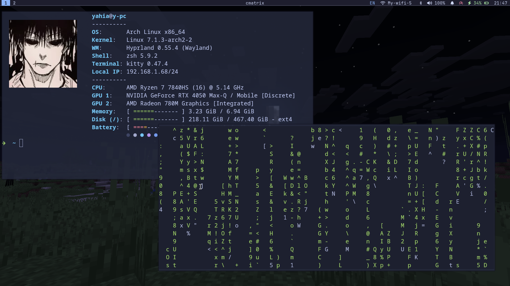
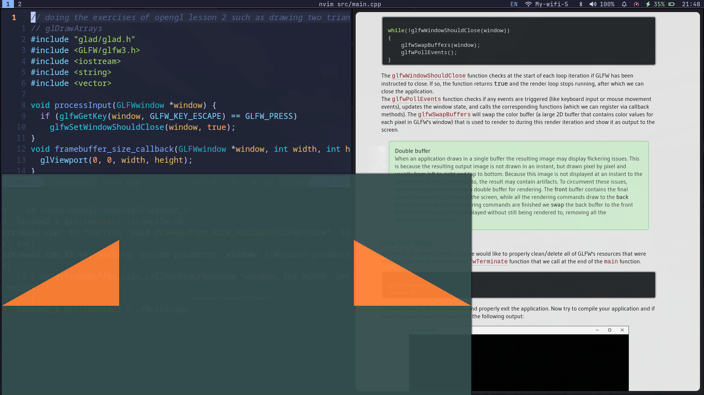
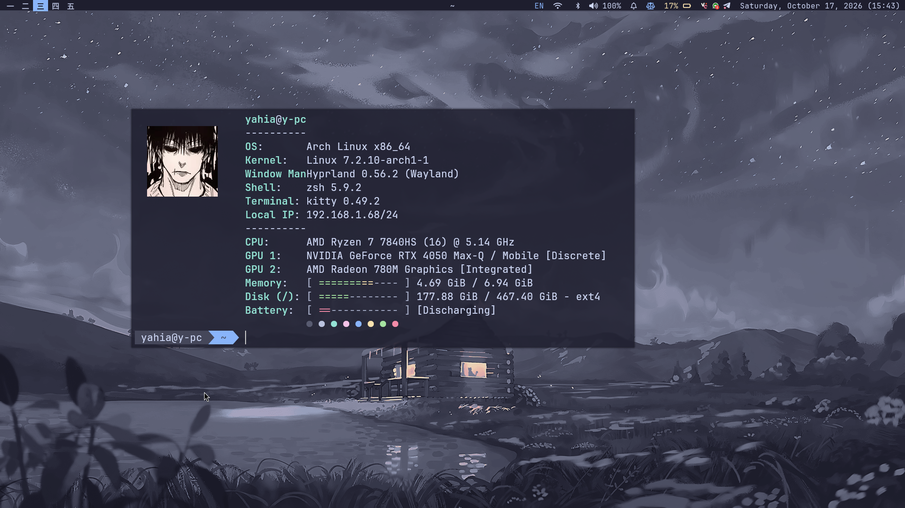

# Hyprland Dotfiles

My personal Hyprland desktop configuration for **Arch Linux**. I use it for everyday work, university, and programming—including learning OpenGL. This is a work in progress, shaped around the way I use my machine rather than a universal desktop setup.

<p align="center">
  <strong>Arch Linux · Hyprland · Lua · Waybar · Catppuccin Mocha</strong>
</p>

## Showcase

<p align="center">
  <strong>Hyprland desktop in action</strong>
</p>


https://github.com/user-attachments/assets/2b16facf-8c12-4ebc-93fa-440a60e79197


<p align="center">
  <sub>
    <a href="assets/screenshots/2026-10-17_15-19-29.mp4">View the MP4 in the repository</a>
  </sub>
</p>
The recording is stored in the repository and linked here. GitHub does not render repository-relative MP4 files as inline players in a README; the link opens the video file. For an inline player, upload the MP4 in the GitHub README editor and use the generated `github.com/user-attachments/assets/...` URL on its own line.

## Screenshots

These screenshots are stored in [`assets/screenshots/`](assets/screenshots/).

<table>
  <tr>
    <td align="center" width="50%">
      <strong>Desktop</strong><br>
      <em>Desktop and Waybar</em><br><br>
      <a href="assets/screenshots/2026-10-17_16-33-15.png"></a>
    </td>
    <td align="center" width="50%">
      <strong>Desktop · Alternate view</strong><br>
      <em>A second view of the session</em><br><br>
      <a href="assets/screenshots/2026-10-17_16-33-16.png"></a>
    </td>
  </tr>
  <tr>
    <td align="center" width="50%">
      <strong>Another view</strong><br>
      <em>Additional desktop screenshot</em><br><br>
      <a href="assets/screenshots/another.png"></a>
    </td>
    <td align="center" width="50%">
      <strong>Application launcher</strong><br>
      <em>Launching applications with Wofi</em><br><br>
      <a href="assets/screenshots/launcher.png"></a>
    </td>
  </tr>
</table>

<details>
  <summary>Earlier screenshots</summary>

  <p align="center">
    <strong>Earlier desktop view</strong><br><br>
    
  </p>
  <p align="center">
    <strong>Earlier tiled-window layout</strong><br><br>
    
  </p>
  <p align="center">
    <strong>Earlier development workflow</strong><br><br>
    
  </p>
</details>

## Features

### Modular Lua configuration

Hyprland settings are split into small modules that are loaded by `.config/hypr/hyprland.lua`:

| Module | Responsibility |
|---|---|
| `monitors.lua` | Monitor mode, position, and scale |
| `programs.lua` | Commands used by application-launcher keybindings |
| `autostart-env.lua` | Startup commands and Wayland/session environment variables |
| `permissions.lua` | Hyprland permission enforcement and explicit screencopy/plugin permissions |
| `lookandfeel.lua` | Colors, gaps, layout, blur, shadows, opacity, and animations |
| `input.lua` | Keyboard layouts, mouse/touchpad behavior, and workspace swipe gesture |
| `misc.lua` | Miscellaneous compositor options |
| `keybinds.lua` | Application, window, workspace, media, and capture shortcuts |
| `submaps.lua` | Temporary resize mode |
| `windowsandworkspaces.lua` | Window rules and workspace-related behavior |
| `switches.lua` | Laptop lid-switch behavior |

This separation keeps individual settings easier to locate and change without turning one file into a giant configuration block.

### Appearance and layout

- **Catppuccin Mocha-inspired palette** with a dark base, blue accent, and consistent colors shared by Hyprland and Waybar.
- **Dwindle tiling layout** with custom animated transitions and easing curves.
- **Subtle transparency and effects:** active windows are fully opaque, inactive windows use slightly reduced opacity, with shadows and a light blur effect.
- **Minimal window geometry:** zero-width borders, square corners, and small inner/outer gaps.
- **Waybar at the top** with workspace icons, focused-window title, active-submap indicator, keyboard layout, network, Bluetooth, audio, notifications, power profile, battery, tray, and clock/calendar.

### Keyboard-first workflow

- Navigate focus and switch workspaces with `Super` and the arrow keys or number row.
- Move tiled windows directionally; move floating windows in small pixel increments using the same modifier pattern.
- Use a dedicated resize submap instead of memorizing many resize shortcuts.
- Toggle the `magic` special workspace as a scratchpad for windows that should be available without occupying a numbered workspace.
- Use a three-finger horizontal touchpad swipe to change workspaces.

### Desktop helpers

- **Wofi** launches applications and is used for clipboard-history selection.
- **Visual clipboard history.** Press `Super+C` to open a Wofi picker powered by `cliphist`. It supports text history, image thumbnails, and previews for local video files copied through Nemo. Image thumbnails are generated with ImageMagick; video previews use FFmpeg. Text entries show readable previews, while other binary entries receive descriptive labels. Selecting an entry restores its content to the system clipboard so it can be pasted normally with `Ctrl+V`, where the target application supports that content type. Clipboard capture uses `wl-paste` watchers for text, images, and Nemo's `x-special/gnome-copied-files` format.
- **Screenshots** use `grim` and `slurp`, save timestamped PNGs in `~/Pictures/Screenshots/`, copy the image to the clipboard with `wl-copy`, and show a short notification.
- **Screen recording** uses `wf-recorder`, saves timestamped MP4s in `~/Videos/Recordings/`, and can record either the full screen or a selected area. Triggering the recording shortcut again sends an interrupt to stop an active recording.
- **Power profile switching** cycles between `performance`, `balanced`, and `power-saver` through `tlpctl`; Waybar shows the current profile.
- **Audio and display controls** are bound to hardware keys for volume, microphone mute, and brightness. `playerctl` handles media playback.
- **Locking and idle behavior** use Hyprlock and Hypridle. The lock helper captures and blurs a background image before starting Hyprlock.
- **Wallpaper and session startup** use `awww`, launch Waybar and SwayNotificationCenter, start Hypridle and the polkit agent, and start configured tray applications and clipboard watchers.
- **Window rules** handle special cases for the OpenGL learning window, Lutris, network settings, audio controls, PolyMC, `hyprland-run`, and XWayland dragging/maximize behavior.
- **Explicit compositor permissions** are enabled; the configuration grants screencopy access to the capture and lock tools and plugin permission to `hyprpm`.

### Components

| Component | Role in this setup |
|---|---|
| [Hyprland](https://hyprland.org/) | Wayland compositor and window manager |
| [Waybar](https://github.com/Alexays/Waybar) | Status bar and system modules |
| [SwayNotificationCenter](https://github.com/ErikReider/SwayNotificationCenter) | Notifications and Do Not Disturb controls |
| [Wofi](https://hg.sr.ht/~scoopta/wofi) | Application launcher and visual clipboard-history picker |
| [Kitty](https://sw.kovidgoyal.net/kitty/) | Terminal |
| [Nemo](https://github.com/linuxmint/nemo) | File manager |
| [Zathura](https://pwmt.org/projects/zathura/) | PDF viewer |
| [grim](https://github.com/emersion/grim) and [slurp](https://github.com/emersion/slurp) | Screenshot and area selection |
| [wf-recorder](https://github.com/ammen99/wf-recorder) | Screen recording |
| [cliphist](https://github.com/sentriz/cliphist) and `wl-clipboard` | Clipboard history and clipboard access |
| [Hyprlock](https://github.com/hyprwm/hyprlock) and [Hypridle](https://github.com/hyprwm/hypridle) | Lock screen and idle management |
| [awww](https://github.com/0x46d/awww) | Wallpaper rendering |
| [Neovim](https://neovim.io/) | Editor, configured through a separate submodule |

Additional app bindings and autostart commands refer to Zen Browser, `helixnotes`, Discord, Telegram, Lutris, Vesktop, Whatsie, and other machine-specific helpers. Those applications are not all required to use Hyprland itself; install or change the ones you want.

## Keybindings

The main modifier is **`Super`** (the Windows key). These are the bindings in the current Lua configuration. A binding that launches an application or script only works when that command is installed and available.

### Applications and session

| Shortcut | Action |
|---|---|
| `Super` + `Enter` | Open Kitty terminal |
| `Super` + `Space` | Open the Wofi application launcher |
| `Super` + `B` | Open Zen Browser |
| `Super` + `E` | Open Nemo file manager |
| `Super` + `N` | Open `helixnotes` |
| `Super` + `Z` | Open Zathura PDF viewer |
| `Super` + `D` | Open Discord |
| `Super` + `T` | Open Telegram |
| `Super` + `W` | Open Whatsie |
| `Super` + `Shift` + `L` | Open Lutris |
| `Super` + `Esc` | Open the custom power menu |
| `Super` + `L` | Lock the screen using the custom lock script |
| `Super` + `Shift` + `Q` | Close the active window |
| `Super` + `A` | Cycle the configured power profile |
| `Super` + `C` | Open visual clipboard history; restore the selected entry to the clipboard |
| `Super` + `Shift` + `Space` | Cycle keyboard layouts using the layout-toggle script |

### Windows and layout

| Shortcut | Action |
|---|---|
| `Super` + arrow keys | Focus a window in that direction |
| `Super` + `Shift` + arrow keys | Move the active window: floating windows move by 15-pixel increments; tiled windows move directionally |
| `Super` + `V` | Toggle floating mode for the active window |
| `Super` + `F` | Toggle fullscreen |
| `Super` + `P` | Toggle pseudo-tiling in the Dwindle layout |
| `Super` + `J` | Toggle the Dwindle split direction |
| `Super` + `R` | Enter the resize submap |
| `Super` + `S` | Toggle the `magic` special workspace |
| `Super` + `Shift` + `S` | Move the active window to the `magic` special workspace |
| `Super` + mouse wheel | Cycle through workspaces |
| `Super` + left mouse button + drag | Move a window |
| `Super` + right mouse button + drag | Resize a window |

### Workspaces

| Shortcut | Action |
|---|---|
| `Super` + `1` … `9` | Focus workspace 1–9 |
| `Super` + `0` | Focus workspace 10 |
| `Super` + `Shift` + `1` … `9` | Move the active window to workspace 1–9 |
| `Super` + `Shift` + `0` | Move the active window to workspace 10 |

### Resize submap

1. Press `Super` + `R` to enter the resize submap.
2. Use an arrow key to resize the active window in that direction. Holding the key repeats the resize in 15-pixel increments.
3. Press `Esc` or `Enter` to return to the normal keybindings.

Waybar displays the active submap next to the workspace indicators, so the temporary mode is visible.

### Screenshots and recordings

| Shortcut | Action |
|---|---|
| `Print` | Capture the full screen, save it, and copy it to the clipboard |
| `Shift` + `Print` | Select and capture an area, save it, and copy it to the clipboard |
| `Super` + `Print` | Start a full-screen recording; press again to stop |
| `Super` + `Shift` + `Print` | Start an area recording; press again to stop |

Screenshots are saved in `~/Pictures/Screenshots/`. Recordings are saved in `~/Videos/Recordings/`. File names use timestamps. Area captures and recordings prompt for a region selection.

### Hardware keys and input

| Key | Action |
|---|---|
| Volume up / down | Change output volume |
| Volume mute | Toggle output mute |
| Microphone mute | Toggle the default audio input mute |
| Brightness up / down | Change display brightness |
| Media next / play / pause / previous | Control playback through `playerctl` |
| Laptop lid switch | Suspend the system |

The configured keyboard layouts are **US English**, **Arabic**, and **Russian** (`us,ara,ru`). A three-finger horizontal touchpad swipe switches workspaces.

## Repository layout

```text
hypr-dotfiles/
├── .config/
│   ├── hypr/
│   │   ├── hyprland.lua
│   │   ├── modules/
│   │   └── scripts/
│   ├── waybar/
│   │   ├── config.jsonc
│   │   ├── style.css
│   │   └── scripts/
│   ├── theme/
│   │   └── colors.css
│   └── nvim/                 # Git submodule
├── assets/
│   └── screenshots/
│       ├── 2026-10-17_15-19-29.mp4
│       ├── 2026-10-17_16-33-15.png
│       ├── 2026-10-17_16-33-16.png
│       ├── another.png
│       └── launcher.png
├── Pictures/
├── .gitmodules
├── .zshrc
└── README.md
```

This is a guide to the main paths, not a complete file listing. The repository also contains scripts and other configuration files beneath `.config/`.

## Installation and setup

This configuration is written for **Arch Linux** and targets the machine and applications I use. It is not a self-contained installer. Review commands and settings before adopting it, especially if you already have a Hyprland setup.

### 1. Clone the repository

Include the Neovim submodule:

```sh
git clone --recurse-submodules https://github.com/yahia098/hypr-dotfiles.git "$HOME/hypr-dotfiles"
```

### 2. Back up existing configuration

Before linking or copying files, back up the matching directories under `~/.config/`. Do not blindly replace your entire `.config` directory. Integrate the directories you want from the checkout—for example, `hypr`, `waybar`, and `theme`—and resolve any existing files or symlinks first.

### 3. Install the tools you plan to use

The package commands below reflect my current Arch Linux workstation. The full Arch command includes applications and development tools beyond what Hyprland itself needs, so review it before running—especially the kernel, NVIDIA driver, bootloader, firewall, and display-manager packages. Package versions are intentionally not pinned.

#### Arch Linux repository packages

```bash
sudo pacman -S --needed 7zip alsa-utils amd-ucode android-file-transfer android-tools awww base base-devel bear blueman bluetui bluez bluez-utils brightnessctl btop clang cliphist cmatrix cppcheck cups cups-pdf dosfstools efibootmgr efitools fastfetch fd ffmpeg ffmpegthumbnailer fuseiso fzf gamemode gamescope git github-cli glm gnome-disk-utility grim grub gst-plugins-bad gst-plugins-base gst-plugins-good gst-plugins-ugly gvfs-mtp hypridle hyprland hyprlock hyprpolkitagent imagemagick jdk-openjdk jq kitty lazygit lib32-gamemode lib32-gcc-libs lib32-mangohud lib32-mesa lib32-mesa-utils lib32-nvidia-utils lib32-vulkan-icd-loader lib32-vulkan-mesa-layers lib32-vulkan-radeon libnotify libpaper libreoffice-fresh linux linux-firmware linux-headers lldb llvm man-db man-pages mangohud mesa nemo neovim networkmanager nodejs noto-fonts-cjk noto-fonts-emoji npm nvidia-open nvidia-prime nvidia-utils nvme-cli nvtop openssh pamixer papirus-icon-theme pavucontrol pipewire-alsa pipewire-pulse playerctl poppler protontricks python python-black python-debugpy qbittorrent qt5-base qt5ct qt6-5compat qt6-multimedia qt6-multimedia-ffmpeg reflector ripgrep rpm-tools rsync ruff rust-analyzer rustup sane sddm sdl12-compat selene shellcheck simple-scan slurp smartmontools sof-firmware steam stylua swaync system-config-printer telegram-desktop texinfo time tldr tlp tlp-pd tlpui tree ttf-jetbrains-mono-nerd ttf-nerd-fonts-symbols ttf-nerd-fonts-symbols-mono ufw unrar unzip uv vulkan-mesa-layers vulkan-radeon vulkan-tools waybar wf-recorder wine wine-gecko wine-mono winetricks wl-clipboard wofi xdg-desktop-portal-hyprland xdg-utils xorg-xwayland zathura zathura-pdf-mupdf zsh flatpak
```

The `nvidia-open` package is for compatible NVIDIA GPUs using Arch's standard `linux` kernel. This command also includes the Mesa/Vulkan packages used by the integrated Radeon GPU and 32-bit graphics libraries for gaming. The `lib32-*` packages require the `[multilib]` repository to be enabled in `/etc/pacman.conf`. If you use a different kernel, select the matching NVIDIA package instead; see the [ArchWiki NVIDIA guide](https://wiki.archlinux.org/title/NVIDIA).

#### AUR packages

Install an AUR helper first if you do not already have one. The following bootstraps `yay` from the AUR:

```bash
git clone https://aur.archlinux.org/yay.git /tmp/yay && cd /tmp/yay && makepkg -si
```

Then install the AUR applications used by the desktop setup:

```bash
yay -S --needed bm-sidebar catppuccin-gtk-theme-mocha helixnotes-bin nm-sidebar pipewire-control-center vesktop-bin zen-browser-bin
```

These additional AUR packages are part of my wider workstation, but are optional for the Hyprland configuration itself:

```bash
yay -S --needed catt cnrdrvcups-ufr2-uk esp-idf localsend
```

The `*-debug` packages are not needed for normal use. AUR packages are community-maintained; inspect their build files and review updates before installing them. See the [ArchWiki AUR guide](https://wiki.archlinux.org/title/Arch_User_Repository).

#### Whatsie through Flatpak

Whatsie is installed separately from Flathub as `com.ktechpit.whatsie`:

```bash
flatpak remote-add --user --if-not-exists flathub https://flathub.org/repo/flathub.flatpakrepo && flatpak install --user flathub com.ktechpit.whatsie
```

See [Whatsie on Flathub](https://flathub.org/en/apps/com.ktechpit.whatsie).

#### Clipboard-history dependencies

The visual clipboard picker uses **Wofi**, `cliphist`, and `wl-clipboard`. Image thumbnails are generated with ImageMagick; local video-file thumbnails use FFmpeg. Python parses file URIs copied from Nemo. The autostart configuration must run clipboard watchers for all three relevant formats:

- `text` — ordinary text copied to the clipboard.
- `image` — copied images.
- `x-special/gnome-copied-files` — file selections copied in Nemo, including local video files.

Wofi is also the application launcher. Fuzzel is not used by the current clipboard picker.

### 4. Review hardware- and machine-specific settings

- `.config/hypr/modules/monitors.lua` defines `eDP-1` at `1920x1080@144`, scale `1`. Change it for your own monitor if needed.
- `.config/hypr/modules/autostart-env.lua` sets Wayland/desktop environment variables and includes NVIDIA-specific values. Review those if your GPU or driver setup differs.
- Autostart includes Telegram, Vesktop, Whatsie, Waybar, SwayNotificationCenter, Hypridle, the polkit agent, wallpaper startup, and clipboard watchers. Disable any application launch you do not want.
- The wallpaper helper references `~/.config/wallpapers/cabin-3.png`; make sure that file exists or change the wallpaper script.
- The lid-switch binding suspends the system. Change it if that is not the behavior you want.
- Permission changes in `permissions.lua` require restarting Hyprland.

For version-specific behavior, consult the [Hyprland wiki](https://wiki.hypr.land/).

## Neovim submodule

Neovim is maintained separately in [yahia098/nvim.dots](https://github.com/yahia098/nvim.dots) and included under `.config/nvim` as a Git submodule. Use `git clone --recurse-submodules` when cloning this repository; if you cloned without submodules, run:

```sh
git submodule update --init --recursive
```

## AI assistance and ownership

I built and maintain this configuration while learning how to customize my Linux desktop. I used documentation, videos, experimentation, and debugging to learn Lua, Bash, JSON, and CSS. I also used ChatGPT to explain concepts, debug issues, and generate some Bash boilerplate.

The overall design, configuration choices, and final implementation are mine. I use this setup for university and personal projects, and I continue to change it by understanding the configuration rather than blindly accepting generated changes.

## License

My intention is to let anyone use and modify this configuration, including for commercial use, without needing to contact me or provide attribution. There is not yet a formal `LICENSE` file in the repository, so this statement records my intent but is not a substitute for adding a standard license.