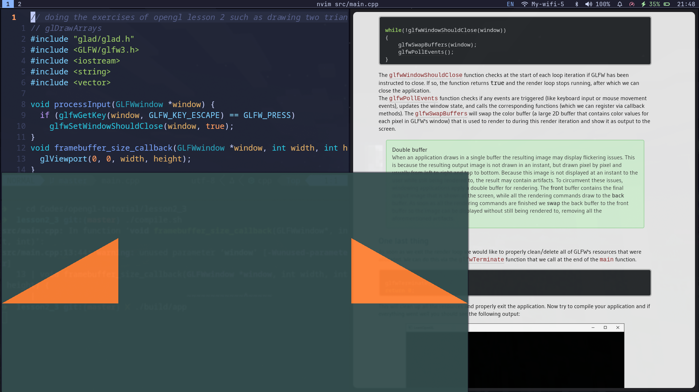
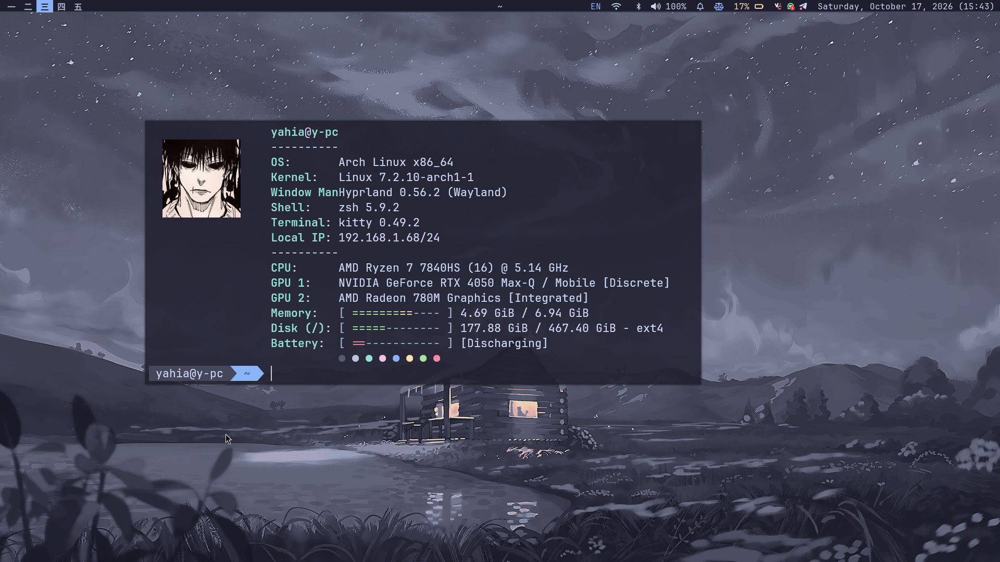
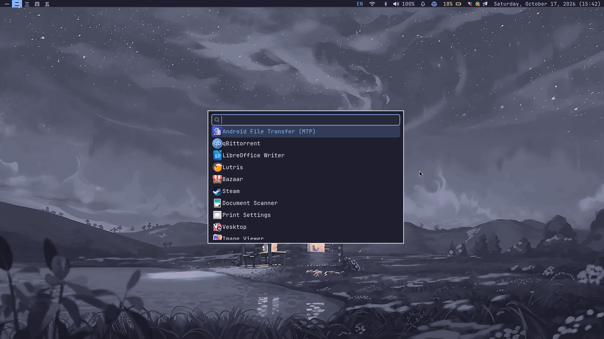

# Hyprland Dotfiles

My personal Hyprland desktop configuration for **Arch Linux**. I use it for everyday work, university, and programming—including learning OpenGL. This is a work in progress, shaped around the way I use my machine rather than a universal desktop setup.

<p align="center">
  <strong>Arch Linux · Hyprland · Lua · Waybar · Matugen</strong>
</p>

## Quick Start

**Requirements:** Arch Linux, Git, Bash, and the applications required by the modules you want to use. Install the rice packages before starting a Hyprland session.

```bash
git clone https://github.com/yahia098/hypr-dotfiles.git ~/hypr-dotfiles
cd ~/hypr-dotfiles
```

1. Review `.config/hypr/hyprland.lua` and its modules, especially monitor settings, startup commands, and hardware-specific options.
2. Install the required dependencies listed in [Installation and setup](#installation-and-setup).
3. Preview the deployment with `./deploy.sh --dry-run`.
4. Deploy with `./deploy.sh`. It creates a timestamped backup before copying configuration files.
5. Log out and select Hyprland from your display manager. After logging in, apply a wallpaper once so Matugen can generate local colour files.

The deployment script merges the repository's configuration into `~/.config`: files with matching names are replaced, but files not shipped by this repository are preserved. Review the scripts before using them on your machine.

## Showcase

<p align="center">
  <strong>Hyprland desktop in action</strong>
</p>

https://github.com/user-attachments/assets/5356a639-1e2a-482b-9023-8efdd35f6f21

<p align="center">
  <sub>
    <a href="assets/screenshots/2026-10-20_06-15-53.mp4">View the MP4 in the repository</a>
  </sub>
</p>

The recording is stored in the repository and linked here. GitHub does not render repository-relative MP4 files as inline players in a README; the link opens the video file.

## Screenshots

The showcase recording and existing screenshots are stored in [assets/screenshots/](assets/screenshots/). The featured desktop screenshot is stored in `assets/screenshots/desktop_sea.png`.

<table>
  <tr>
    <td align="center" width="50%">
      <strong>Desktop screenshot</strong><br>
      <a href="assets/screenshots/desktop_sea.png">
        
      </a>
    </td>
    <td align="center" width="50%">
      <strong>Desktop · Alternate view</strong><br>
      <em>A second view of the session</em><br><br>
      <a href="assets/screenshots/2026-10-17_16-33-16.png">
        
      </a>
    </td>
  </tr>
  <tr>
    <td align="center" width="50%">
      <strong>Another view</strong><br>
      <em>Additional desktop screenshot</em><br><br>
      <a href="assets/screenshots/another.png">
        
      </a>
    </td>
    <td align="center" width="50%">
      <strong>Application launcher</strong><br>
      <em>Launching applications with Wofi</em><br><br>
      <a href="assets/screenshots/launcher.png">
        
      </a>
    </td>
  </tr>
</table>

<details>
  <summary>Earlier screenshots</summary>

  <p align="center">
    <strong>Earlier desktop view</strong><br><br>
    
  </p>
  <p align="center">
    <strong>Earlier tiled-window layout</strong><br><br>
    
  </p>
  <p align="center">
    <strong>Earlier development workflow</strong><br><br>
    
  </p>
</details>

## Features

### Modular Lua configuration

Hyprland settings are split into small modules loaded by `.config/hypr/hyprland.lua`:

| Module                     | Responsibility                                                             |
| -------------------------- | -------------------------------------------------------------------------- |
| `monitors.lua`             | Monitor mode, position, and scale                                          |
| `programs.lua`             | Commands used by application-launcher keybindings                          |
| `autostart-env.lua`        | Startup commands and Wayland/session environment variables                 |
| `permissions.lua`          | Hyprland permission enforcement and explicit screencopy/plugin permissions |
| `lookandfeel.lua`          | Colors, gaps, layout, blur, shadows, opacity, and animations               |
| `input.lua`                | Keyboard layouts, mouse/touchpad behavior, and workspace swipe gesture     |
| `misc.lua`                 | Miscellaneous compositor options                                           |
| `keybinds.lua`             | Application, window, workspace, media, and capture shortcuts               |
| `submaps.lua`              | Temporary resize mode                                                      |
| `windowsandworkspaces.lua` | Window rules and workspace-related behavior                                |
| `switches.lua`             | Laptop lid-switch behavior                                                 |

This separation keeps individual settings easier to locate and change without turning one file into a giant configuration block.

Matugen source templates live in `.config/matugen/templates/`; generated colour files are runtime outputs, not source files, and are intentionally not tracked by Git.

### Matugen, GTK, Papirus, and wallpapers

The wallpaper workflow is designed around Wofi and Matugen.

The wallpaper picker lists images in `~/.config/wallpapers`, asks Matugen for the wallpaper's source colours, and lets you select which colour should drive the palette.

It then calls `set-wallpaper.sh`, which displays the image with `awww`, runs Matugen with the `scheme-smart` scheme and selected source-colour index, and reloads Hyprland.

The picker can be launched manually; it is not automatically started by the current `autostart-env.lua` because its startup line is commented out.

Matugen's `config.toml` connects each source template to its generated output. Keep the templates and `config.toml` in Git, but ignore wallpaper-dependent output files such as:

- `theme/colors.css`
- `gtk-3.0/colors.css`
- `gtk-4.0/colors.css`
- `hypr/lua/matugen-colors.lua`
- `hypr/matugen-lock.conf`
- `yazi/theme.toml`

Apply a wallpaper once after installation so those outputs are generated locally.

GTK uses `adw-gtk3-dark` as its base theme and the desktop colour scheme is set to prefer dark. Both `gtk-3.0/gtk.css` and `gtk-4.0/gtk.css` import their corresponding generated `colors.css`.

The shared `.config/theme/colors.css` file is also used by components such as Waybar and Wofi.

Matugen also selects the closest matching Papirus folder colour to its primary palette colour. The Papirus command is launched in the background so wallpaper selection does not have to wait for the icon-cache work.

Its hook uses `sudo -n`, so it requires a narrowly scoped sudoers rule allowing your own account to run `/usr/bin/papirus-folders` without a password.

Dunst is the active notification daemon. Matugen writes its configuration from `.config/matugen/templates/dunstrc` to `.config/dunst/dunstrc`; the configured hook requests a Dunst reload after generation.

### Appearance and layout

- **Wallpaper-driven Matugen palette** shared by Hyprland, Kitty, Waybar, Wofi, Yazi, Hyprlock, Dunst, and GTK colour overrides.
- **Master tiling layout** as the primary window-management layout.
- **Subtle transparency and effects:** active windows are fully opaque, inactive windows use slightly reduced opacity, with shadows and a light blur effect.
- **Minimal window geometry:** zero-width borders, square corners, and small inner/outer gaps.
- **GTK theming:** `adw-gtk3-dark` with Matugen-generated colour overrides.
- **Waybar at the top** with workspace icons, focused-window title, active-submap indicator, keyboard layout, network, Bluetooth, audio, power profile, battery, tray, and clock/calendar.

### Keyboard-first workflow

- Navigate focus and switch workspaces with `Super` and the arrow keys or number row.
- Move tiled windows directionally; move floating windows in small pixel increments using the same modifier pattern.
- Use a dedicated resize submap instead of memorizing many resize shortcuts.
- Toggle the `magic` special workspace as a scratchpad for windows that should be available without occupying a numbered workspace.
- Use a three-finger horizontal touchpad swipe to change workspaces.

### Desktop helpers

- **Wofi** launches applications and is used for clipboard-history selection.
- **Visual clipboard history.** Press `Super` + `C` to open a Wofi picker powered by `cliphist`. It supports text history, image thumbnails, and previews for local video files copied through Nautilus. Image thumbnails are generated with ImageMagick; video previews use FFmpeg.
- **Screenshots** use `grim` and `slurp`, save timestamped PNGs in `~/Pictures/Screenshots/`, copy the image to the clipboard with `wl-copy`, and show a short notification.
- **Screen recording** uses `wf-recorder`, saves timestamped MP4s in `~/Videos/Recordings/`, and can record either the full screen or a selected area.
- **Power profile switching** cycles between `performance`, `balanced`, and `power-saver` through `tlpctl`; Waybar shows the current profile.
- **Audio and display controls** are bound to hardware keys for volume, microphone mute, and brightness. `playerctl` handles media playback.
- **Locking and idle behavior** use Hyprlock and Hypridle. The lock helper captures and blurs a background image before starting Hyprlock.
- **Wallpaper and session startup** use `awww`, launch Waybar and Dunst, start Hypridle and the polkit agent, and start configured applications and clipboard watchers.
- **Window rules** handle special cases for the OpenGL learning window, Lutris, network settings, audio controls, PolyMC, `hyprland-run`, and XWayland dragging/maximize behavior.
- **Explicit compositor permissions** are enabled; the configuration grants screencopy access to the capture and lock tools and plugin permission to `hyprpm`.

### Components

| Component                                                                                         | Role in this setup                                                                                        |
| ------------------------------------------------------------------------------------------------- | --------------------------------------------------------------------------------------------------------- |
| [Hyprland](https://hyprland.org/)                                                                 | Wayland compositor and window manager                                                                     |
| [Waybar](https://github.com/Alexays/Waybar)                                                       | Status bar and system modules                                                                             |
| [Dunst](https://github.com/dunst-project/dunst)                                                   | Lightweight notification daemon                                                                           |
| [Matugen](https://github.com/InioX/matugen)                                                       | Generates wallpaper-derived colours for the desktop                                                       |
| [Adw-gtk3](https://github.com/lassekongo83/adw-gtk3)                                              | GTK theme with Matugen colour overrides                                                                   |
| [Wofi](https://hg.sr.ht/~scoopta/wofi)                                                            | Application launcher and visual clipboard-history picker                                                  |
| [Kitty](https://sw.kovidgoyal.net/kitty/)                                                         | Terminal                                                                                                  |
| [Nautilus](https://apps.gnome.org/Nautilus/)                                                      | File manager                                                                                              |
| [Evince](https://apps.gnome.org/Evince/)                                                          | PDF viewer                                                                                                |
| [grim](https://github.com/emersion/grim) and [slurp](https://github.com/emersion/slurp)           | Screenshot and area selection                                                                             |
| [wf-recorder](https://github.com/ammen99/wf-recorder)                                             | Screen recording                                                                                          |
| [cliphist](https://github.com/sentriz/cliphist) and `wl-clipboard`                                | Clipboard history and clipboard access                                                                    |
| [Hyprlock](https://github.com/hyprwm/hyprlock) and [Hypridle](https://github.com/hyprwm/hypridle) | Lock screen and idle management                                                                           |
| [awww](https://github.com/0x46d/awww)                                                             | Wallpaper rendering                                                                                       |
| [Yazi](https://yazi-rs.github.io/) | Terminal file manager, themed by Matugen |
| [Neovim](https://neovim.io/)                                                                      | Editor; its configuration is maintained in [a separate repository](https://github.com/yahia098/nvim.dots) |

Additional app bindings and autostart commands refer to Helix Notes, Telegram, Vesktop, Whatsie, Lutris, and other machine-specific helpers. These applications are not all required to use Hyprland itself.

## Keybindings

The main modifier is **`Super`** (the Windows key). These are the bindings documented for the current Lua configuration. A binding that launches an application or script only works when that command is installed and available.

### Applications and session

| Shortcut                    | Action                                                                     |
| --------------------------- | -------------------------------------------------------------------------- |
| `Super` + `Enter`           | Open Kitty terminal                                                        |
| `Super` + `Space`           | Open the Wofi application launcher                                         |
| `Super` + `B`               | Open the configured browser, if installed                                  |
| `Super` + `E`               | Open Nautilus file manager                                                 |
| `Super` + `N`               | Open Helix Notes                                                           |
| `Super` + `Z`               | Open Evince PDF viewer                                                     |
| `Super` + `D`               | Open Vesktop                                                               |
| `Super` + `T`               | Open Telegram                                                              |
| `Super` + `W`               | Open Whatsie                                                               |
| `Super` + `Shift` + `L`     | Open Lutris                                                                |
| `Super` + `Esc`             | Open the custom power menu                                                 |
| `Super` + `L`               | Lock the screen using the custom lock script                               |
| `Super` + `Shift` + `Q`     | Close the active window                                                    |
| `Super` + `A`               | Cycle the configured power profile                                         |
| `Super` + `C`               | Open visual clipboard history; restore the selected entry to the clipboard |
| `Super` + `Shift` + `Space` | Cycle keyboard layouts using the layout-toggle script                      |

### Windows and layout

| Shortcut                            | Action                                                                                                 |
| ----------------------------------- | ------------------------------------------------------------------------------------------------------ |
| `Super` + arrow keys                | Focus a window in that direction                                                                       |
| `Super` + `Shift` + arrow keys      | Move the active window: floating windows move by 15-pixel increments; tiled windows move directionally |
| `Super` + `V`                       | Toggle floating mode for the active window                                                             |
| `Super` + `F`                       | Toggle fullscreen                                                                                      |
| `Super` + `R`                       | Enter the resize submap                                                                                |
| `Super` + `S`                       | Toggle the `magic` special workspace                                                                   |
| `Super` + `Shift` + `S`             | Move the active window to the `magic` special workspace                                                |
| `Super` + mouse wheel               | Cycle through workspaces                                                                               |
| `Super` + left mouse button + drag  | Move a window                                                                                          |
| `Super` + right mouse button + drag | Resize a window                                                                                        |

### Workspaces

| Shortcut                      | Action                                  |
| ----------------------------- | --------------------------------------- |
| `Super` + `1` … `9`           | Focus workspace 1–9                     |
| `Super` + `0`                 | Focus workspace 10                      |
| `Super` + `Shift` + `1` … `9` | Move the active window to workspace 1–9 |
| `Super` + `Shift` + `0`       | Move the active window to workspace 10  |

### Resize submap

1. Press `Super` + `R` to enter the resize submap.
2. Use an arrow key to resize the active window in that direction. Holding the key repeats the resize in 15-pixel increments.
3. Press `Esc` or `Enter` to return to the normal keybindings.

Waybar displays the active submap next to the workspace indicators, so the temporary mode is visible.

### Screenshots and recordings

| Shortcut                    | Action                                                            |
| --------------------------- | ----------------------------------------------------------------- |
| `Print`                     | Capture the full screen, save it, and copy it to the clipboard    |
| `Shift` + `Print`           | Select and capture an area, save it, and copy it to the clipboard |
| `Super` + `Print`           | Start a full-screen recording; press again to stop                |
| `Super` + `Shift` + `Print` | Start an area recording; press again to stop                      |

Screenshots are saved in `~/Pictures/Screenshots/`. Recordings are saved in `~/Videos/Recordings/`. File names use timestamps.

### Hardware keys and input

| Key                                  | Action                               |
| ------------------------------------ | ------------------------------------ |
| Volume up / down                     | Change output volume                 |
| Volume mute                          | Toggle output mute                   |
| Microphone mute                      | Toggle the default audio input mute  |
| Brightness up / down                 | Change display brightness            |
| Media next / play / pause / previous | Control playback through `playerctl` |
| Laptop lid switch                    | Suspend the system                   |

The configured keyboard layouts are **US English**, **Arabic**, and **Russian** (`us,ara,ru`). A three-finger horizontal touchpad swipe switches workspaces.

## Repository layout

```text
hypr-dotfiles/
├── .config/
│   ├── gtk-3.0/
│   │   └── gtk.css             # Imports generated colors.css
│   ├── gtk-4.0/
│   │   └── gtk.css             # Imports generated colors.css
│   ├── hypr/
│   │   ├── hyprland.lua
│   │   ├── modules/
│   │   └── scripts/
│   ├── matugen/
│   │   ├── config.toml
│   │   └── templates/          # Source templates, including Dunst and browser CSS
│   ├── wallpapers/             # Wallpaper images selected by the Wofi picker
│   ├── waybar/
│   │   ├── config.jsonc
│   │   ├── style.css
│   │   └── scripts/
│   └── zathura/                # Optional Zathura settings
├── assets/
│   └── screenshots/            # Screenshots and showcase recording
├── .gitignore
├── .zshrc
└── README.md
```

Generated colour files (including `gtk-3.0/colors.css`, `gtk-4.0/colors.css`, `theme/colors.css`, Matugen's Hyprland colour files, and `yazi/theme.toml`) may exist locally but are not source files tracked in Git.

This is a guide to the main paths, not a complete file listing. The repository also contains scripts and other configuration files beneath `.config/`.

## Installation and setup

This configuration targets **Arch Linux**. The installers are intentionally split into four independent tasks; they do not install a general workstation package set.

### 1. Clone the repository

```sh
git clone https://github.com/yahia098/hypr-dotfiles.git "$HOME/hypr-dotfiles"
cd "$HOME/hypr-dotfiles"
```

### 2. Install the rice runtime

```bash
./install_rice_packages.sh
```

Installs the packages referenced by the rice itself, including its AUR utilities. It requires an already-installed `yay` or `paru`. If neither helper exists, it exits before installing anything; it will not bootstrap an AUR helper for you.

### 3. Install gaming software (optional)

```bash
./install_gaming.sh
```

This installs Steam, Lutris, Wine/Proton utilities, GameMode, Gamescope, MangoHud, and Vulkan tooling. Enable the `[multilib]` repository in `/etc/pacman.conf` first. Run the driver installer before this one so the script can add the matching 32-bit NVIDIA and/or AMD Vulkan userspace packages.

### 4. Install GPU drivers (optional)

Choose one or both vendors:

```bash
./install_drivers.sh --nvidia
./install_drivers.sh --amd
./install_drivers.sh --nvidia --amd  # hybrid systems
```

`--nvidia` installs the open NVIDIA kernel module and userspace packages (for supported GPUs). `--amd` installs Mesa and RADV Vulkan userspace. The script requires at least one option and does not guess your hardware.

### 5. Install personal applications and development tools

```bash
./install_my_apps.sh
```

Installs Telegram Desktop, Vesktop, and Whatsie (Flatpak), plus the development stack: Neovim/Neovide, C/C++ compilers and debugging tools, Python, Java, Rust, Node.js, SDL3 and its image/audio/font libraries, and ESP-IDF. Vesktop and ESP-IDF are installed from the AUR; this script requires an existing `yay` or `paru` and exits before installing anything if neither is present. Whatsie is installed from a per-user Flathub remote. Telegram Desktop is an official Arch Extra package; Whatsie uses the Flathub app ID `com.ktechpit.whatsie`.

The script also installs the stable Rust toolchain and Clippy, then clones [your Neovim configuration](https://github.com/yahia098/nvim.dots) into `~/.config/nvim`. If a different Neovim configuration already exists, it is moved to a timestamped `~/.config/nvim.backup-*` directory first. If your own `nvim.dots` clone is already present, the script leaves it untouched.

After installation, activate ESP-IDF in a shell with `source /opt/esp-idf/export.sh`. To make that convenient in zsh, add this function to `~/.zshrc`:

```zsh
esp() {
  git config --global --get-all safe.directory | grep -qx '/opt/esp-idf' || \
    git config --global --add safe.directory /opt/esp-idf
  source /opt/esp-idf/export.sh
}
```

Then open a new terminal and run `esp` before using `idf.py`. If flashing fails with a serial-port permission error, inspect the device's group and add your user to the appropriate group (commonly `uucp` or `lock` on Arch) rather than running the tool as root.

### 6. Back up and deploy the configuration

Preview the files that would be deployed:

```bash
./deploy.sh --dry-run
```

Deploy interactively (recommended):

```bash
./deploy.sh
```

For a reviewed, non-interactive deployment:

```bash
./deploy.sh --yes
```

`deploy.sh` always runs `backup.sh` first. It backs up every top-level entry under this repository's `.config/` directory and the repository `.zshrc`, but only when the corresponding destination already exists in your home directory. It then copies the repository configuration into `~/.config/` and `.zshrc` into `~/.zshrc`.

The deployment is a **merge**, not a destructive mirror: matching files are overwritten after backup, while extra files in your existing config directories are kept. It does not run `rm`, delete unrelated config files, or replace your entire `~/.config` directory. It refuses symlinked destination roots rather than silently writing through them.

You can create a backup independently at any time:

```bash
./backup.sh
./backup.sh --dry-run
./backup.sh --output-dir /path/to/backups
```

Backups are stored by default in `~/.local/state/hypr-dotfiles/backups/` (or `$XDG_STATE_HOME/hypr-dotfiles/backups/` when `XDG_STATE_HOME` is set). Each backup is a timestamped `.tar.gz` archive plus a readable `.manifest.txt` file. Inspect an archive before restoring it:

```bash
tar -tzvf ~/.local/state/hypr-dotfiles/backups/hypr-rice-backup-TIMESTAMP.tar.gz
```

Restore a selected archive by extracting it into your home directory. This overwrites the current versions of the archived paths, so back up the current state first if you need to preserve it:

```bash
tar -xzvf /path/to/hypr-rice-backup-TIMESTAMP.tar.gz -C "$HOME"
```

### 7. Review machine-specific settings

- `.config/hypr/modules/monitors.lua` defines a specific `eDP-1` mode; change it for your display.
- `.config/hypr/modules/autostart-env.lua` includes NVIDIA-specific environment settings. Review them on non-NVIDIA systems.
- The wallpaper picker reads images from `~/.config/wallpapers/`.
- The lid-switch binding suspends the system; change it if that is not desired.

The installers install packages; `deploy.sh` and `backup.sh` manage user configuration files. None of these scripts enables services, modifies sudoers, configures a bootloader, or changes your display manager/session selection. Review AUR PKGBUILDs and updates before installing community packages.

For version-specific behavior, consult the [Hyprland wiki](https://wiki.hypr.land/).

## Neovim

The app installer clones [yahia098/nvim.dots](https://github.com/yahia098/nvim.dots) into `~/.config/nvim`. Update it separately with `git -C ~/.config/nvim pull --ff-only`.

This repository documents the Hyprland desktop configuration; keep Neovim configuration changes in its own repository rather than copying generated Neovim colour output into this one.

## AI assistance and ownership

I built and maintain this configuration while learning how to customize my Linux desktop. I used documentation, videos, experimentation, and debugging to learn Lua, Bash, JSON, and CSS. I also used ChatGPT and Claude to explain concepts, debug issues, generate some Bash boilerplate, and help write and update this README.

The overall design, configuration choices, and final implementation are mine. I use this setup for university and personal projects, and I continue to change it by understanding the configuration rather than blindly accepting generated changes.

## License

My intention is to let anyone use and modify this configuration, including for commercial use, without needing to contact me or provide attribution. There is not yet a formal `LICENSE` file in the repository, so this statement records my intent but is not a substitute for adding a standard license.
