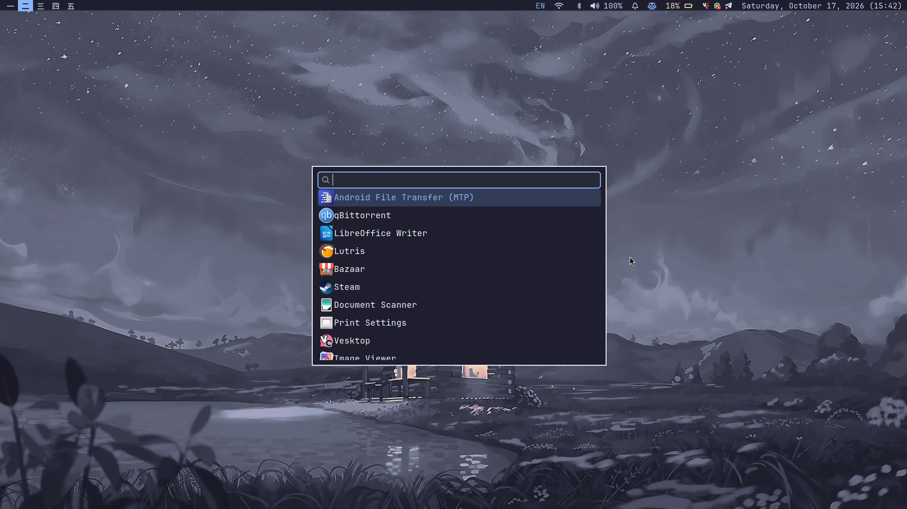

# Hyprland Dotfiles

My personal Hyprland desktop configuration for Arch Linux. I use it for everyday work, university, and programming—including learning OpenGL. The setup is a work in progress and evolves with my workflow.

<p align="center">
  <strong>Arch Linux · Hyprland · Lua · Waybar</strong>
</p>

## Showcase

<!-- SCREEN RECORDING SLOT
     1. Add a GIF at assets/showcase.gif and uncomment the image snippet below, OR
     2. Upload an MP4 to GitHub and replace the placeholder link with its URL.

<p align="center">
  
</p>
-->


<!-- For a GitHub-hosted video, replace the placeholder below with the video URL. -->
<!-- **Watch the desktop tour:** [Screen recording](PASTE_VIDEO_URL_HERE) -->


## Screenshots

<p align="center">
  <strong>Desktop</strong><br>
  <em>My desktop layout and status bar</em><br><br>
  
</p>

<p align="center">
  <strong>Window layout</strong><br>
  <em>Tiled windows during a normal session</em><br><br>
  
</p>

<p align="center">
  <strong>Development workflow</strong><br>
  <em>Windows arranged while learning OpenGL</em><br><br>
  
</p>

<!-- EXTRA SCREENSHOT SLOT
     Upload another screenshot to the repository (for example, assets/screenshots/launcher.png),
     then duplicate this snippet and change the path and alt text:

<p align="center">
  <strong>Launcher / settings / another workflow</strong><br>
  
</p>
-->

## Features

- **Modular Lua configuration.** Hyprland settings are split into modules for monitors, programs, startup and environment variables, permissions, appearance, input, miscellaneous settings, keybindings, submaps, window rules, and device switches.
- **Catppuccin-inspired appearance.** Dark surfaces, a blue accent, subtle shadows, blur, and animated window/workspace transitions. The configuration uses the Dwindle layout and preserves splits.
- **Waybar status bar.** Displays workspaces, the active submap, the focused window, keyboard layout, network, Bluetooth, audio, notifications, power profile, battery, tray, and clock.
- **Keyboard-first workflow.** Launch apps, navigate focus, move windows, switch workspaces, toggle floating/fullscreen, and resize windows without reaching for the mouse.
- **Dedicated resize submap.** Press `Super+R`, then use the arrow keys to resize the active window in small increments. `Esc` or `Enter` exits the submap. Waybar shows the active submap.
- **Screenshots and screen recording.** Full-screen and area captures use `grim` and `slurp`; recordings use `wf-recorder`. Screenshots are saved under `~/Pictures/Screenshots`, recordings under `~/Videos/Recordings`. Screenshot scripts also copy the image to the clipboard.
- **Clipboard history.** `Super+C` opens `cliphist` through Fuzzel and copies the selected entry.
- **Laptop controls.** Media keys handle volume, microphone mute, brightness, and playback. A shortcut and Waybar module toggle the configured TLP power profile.
- **Startup and session integration.** Starts Waybar, SwayNotificationCenter, Hypridle, wallpaper handling, clipboard history watchers, and selected tray applications. It also sets Wayland-related environment variables.
- **Per-window rules.** Includes behavior for apps/windows such as the OpenGL learning window, Lutris, network settings, audio controls, and PolyMC.
- **Separate Neovim configuration.** Neovim is included as a Git submodule pointing to [yahia098/nvim.dots](https://github.com/yahia098/nvim.dots).

## Keybindings

The main modifier is **`Super`** (the Windows key). These bindings are documented from the current Lua configuration; app commands require their corresponding programs to be installed.

### Applications and session

| Shortcut | Action |
|---|---|
| `Super+Enter` | Open Kitty terminal |
| `Super+Space` | Open the Wofi application launcher |
| `Super+B` | Open Zen Browser |
| `Super+E` | Open Nemo file manager |
| `Super+N` | Open `helixnotes` |
| `Super+Z` | Open Zathura PDF viewer |
| `Super+D` | Open Discord |
| `Super+T` | Open Telegram |
| `Super+Shift+L` | Open Lutris |
| `Super+Esc` | Open the custom power menu script |
| `Super+L` | Lock the screen using the custom lock script |
| `Super+A` | Toggle the configured power profile |
| `Super+C` | Open clipboard history and copy the selected entry |
| `Super+Shift+Space` | Cycle keyboard layouts using the layout-toggle script |

### Windows and layout

| Shortcut | Action |
|---|---|
| `Super+Arrow keys` | Focus the window in that direction |
| `Super+Shift+Arrow keys` | Move the active window; floating windows move by small steps, tiled windows move in the indicated direction |
| `Super+V` | Toggle floating mode for the active window |
| `Super+F` | Toggle fullscreen |
| `Super+P` | Toggle pseudo-tiling (Dwindle layout) |
| `Super+J` | Toggle the Dwindle split direction |
| `Super+R` | Enter the resize submap |
| `Super+S` | Toggle the special workspace named `magic` |
| `Super+Shift+S` | Move the active window to the `magic` special workspace |
| `Super+Mouse wheel` | Move to the next/previous workspace |
| `Super+Left mouse button` + drag | Move a window |
| `Super+Right mouse button` + drag | Resize a window |

### Workspaces

| Shortcut | Action |
|---|---|
| `Super+1` … `Super+9` | Focus workspace 1–9 |
| `Super+0` | Focus workspace 10 |
| `Super+Shift+1` … `Super+Shift+9` | Move the active window to workspace 1–9 |
| `Super+Shift+0` | Move the active window to workspace 10 |

### Resize submap

1. Press `Super+R` to enter the submap.
2. Press an arrow key to resize the active window in that direction.
3. Press `Esc` or `Enter` to return to the normal keybindings.

### Screenshots and recordings

| Shortcut | Action |
|---|---|
| `Print` | Capture the full screen, save it, and copy it to the clipboard |
| `Shift+Print` | Select and capture a screen area, save it, and copy it to the clipboard |
| `Super+Print` | Start a full-screen recording; press again to stop it |
| `Super+Shift+Print` | Start an area recording; press again to stop it |

Recordings are saved as timestamped MP4 files in `~/Videos/Recordings`. Starting a new recording while `wf-recorder` is running stops the current recording. Area recording prompts for a region selection.

### Hardware keys

| Key | Action |
|---|---|
| Volume up / down | Change volume |
| Volume mute | Toggle output mute |
| Microphone mute | Toggle the default audio input mute |
| Brightness up / down | Change display brightness |
| Media next / play-pause / previous | Control media playback through `playerctl` |

The laptop lid switch is configured to suspend the system. Keyboard-layout cycling is handled by the script and currently uses the layouts configured in `input.lua`; review that module if your preferred layouts differ.

## Installation and setup

This configuration is written for **Arch Linux** and targets the setup described in the repository. Review the configuration before using it on another machine; monitor names, GPU environment variables, applications, and scripts may need adjustment.

### 1. Clone the repository

Clone into a dedicated directory rather than directly into `$HOME`. Include the Neovim submodule:

```sh
git clone --recurse-submodules https://github.com/yahia098/hypr-dotfiles.git "$HOME/hypr-dotfiles"
```

### 2. Review the configuration

The main files are under `.config/`. In particular, review:

- `.config/hypr/hyprland.lua` and `.config/hypr/modules/` for the compositor configuration.
- `.config/hypr/scripts/` for lock, power, keyboard-layout, screenshot, recording, and wallpaper scripts.
- `.config/waybar/` for the status bar and its helper scripts.
- `.config/nvim/` for the Neovim submodule.

Back up your existing configuration before copying or linking anything into `~/.config/`. This repository is not an automatic installer, and blindly copying everything may overwrite settings you want to keep.

### 3. Install the required tools

The current configuration references the following core tools and applications. Install the relevant packages with your preferred Arch package source and verify optional applications separately:

- Desktop: Hyprland, Waybar, SwayNotificationCenter, Hypridle, Hyprlock, `hyprpolkitagent`, and `xdg-desktop-portal-hyprland`.
- Launching and desktop utilities: Kitty, Wofi, Fuzzel (used by clipboard history), Nemo, Zen Browser, Zathura, `wl-clipboard`, `cliphist`, `jq`, and `libnotify`.
- Captures and media: `grim`, `slurp`, `wf-recorder`, `playerctl`, and `pavucontrol`.
- Other commands invoked by the configuration: `awww`, TLP, Telegram, Vesktop, Whatsie, plus the custom helper commands/scripts referenced in Waybar.

Some applications may come from sources outside the official repositories. The exact package names and availability can change; install only what you need and inspect the scripts before enabling them.

### 4. Check machine-specific settings

- `.config/hypr/modules/monitors.lua` contains an `eDP-1` monitor mode of `1920x1080@144`; change it for your display if necessary.
- `.config/hypr/modules/autostart-env.lua` sets desktop environment variables and includes NVIDIA-specific variables. Review these if your hardware differs.
- Confirm that all programs used by keybindings and autostart are installed and available in `PATH`.
- Ensure the scripts under `.config/hypr/scripts/` and `.config/waybar/scripts/` are executable.
- Log out and start Hyprland after integrating the configuration. Read the [Hyprland wiki](https://wiki.hypr.land/) when troubleshooting version-specific behavior.

## AI assistance and ownership

I built and maintain this configuration while learning how to customize my Linux desktop. I used documentation, videos, experimentation, and debugging to learn Lua, Bash, JSON, and CSS. I also used ChatGPT to explain concepts, debug issues, and generate some Bash boilerplate.

The overall design, configuration choices, and final implementation are mine. I use this setup for university and personal projects, and I continue to modify it by understanding the configuration rather than blindly accepting generated changes.

## License

I allow anyone to use, modify, and use this code commercially without needing to contact me or provide attribution. This statement reflects my intended permission; a standard license file has not been added yet.
